<!--
Copyright (C) 2026 Hyprism Launcher
SPDX-License-Identifier: GPL-3.0-only
-->

<div align="center">

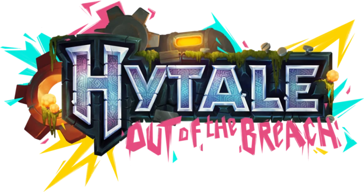

# HytaleMobile

**Hytale running natively on Android, from your own account and game files.**

The macOS arm64 client runs straight on the phone's CPU: no emulator, no FEX, no Box64.<br>
A Mach-O loader translates only the operating system, and a bundled Java 25 runs the local world server on the phone.


<a href="LICENSE"></a>

<a href="#%EF%B8%8F-how-it-works"></a>
<a href="Docs/content/en/development/android.mdx"></a>
<a href="https://www.youtube.com/@belmante"></a>

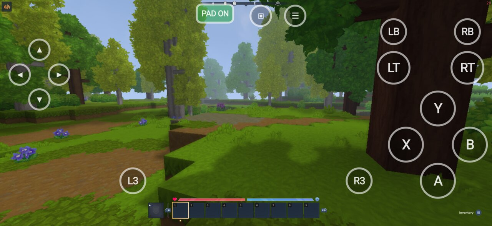

<sub>A local world on a Galaxy S23, with the server running on the phone and the game's own lighting: sunlight, sky ambient and shadows.</sub>

</div>

---

> [!IMPORTANT]
> **No game files are included.** This project doesn't contain Hytale, its client, server or assets. You need your own Hytale account: the app signs in with it and downloads the official **macOS** build from Hytale's servers onto the phone (release 0.7.7, build 39, was tested).

> [!NOTE]
> This is a fork of the [Hyprism](https://github.com/hyprismteam/Hyprism) launcher. It is a work in progress tested on one phone, and it isn't affiliated with Hypixel Studios.

## 📸 Screenshots

<div align="center">

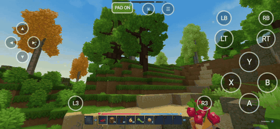

<sub>Recorded on the phone (with the earlier round touch buttons).</sub>

| Touch controls | Launcher |
|:---:|:---:|
| 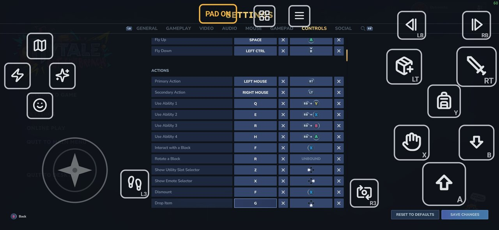 | 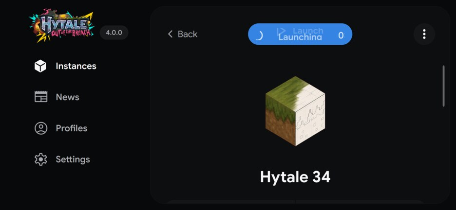 |
| **Combat** | **Main menu with your avatar** |
| 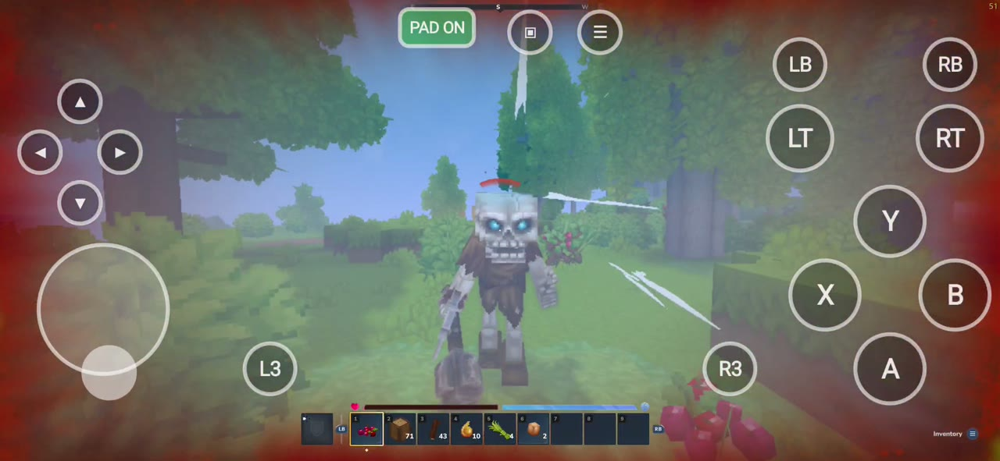 | 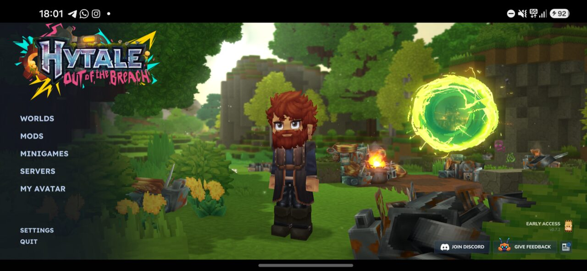 |

</div>

## 🧭 Evolution

From the first window to a local world with the server on the phone, in order:

| # | Step | |
|:---:|---|:---:|
| 1 | The Hyprism launcher as an APK, signing in with the official account | 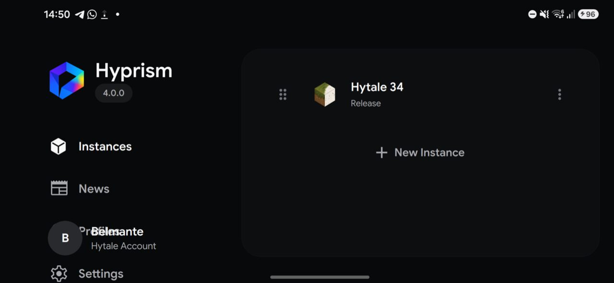 |
| 2 | The macOS client's first window: no OpenGL yet | 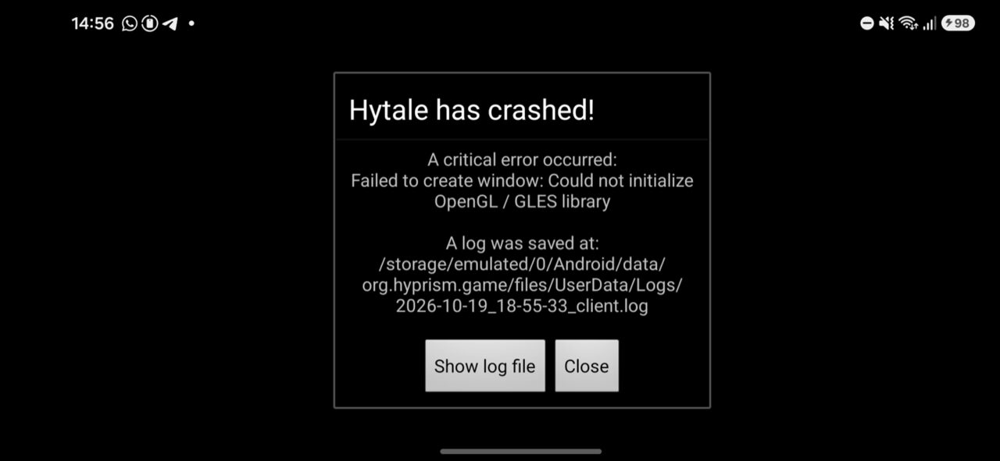 |
| 3 | Out of memory from the .NET thunk pool, fixed with 16 KiB-aligned `vm_remap` |  |
| 4 | Main menu with the 3D scene, but no interface images | 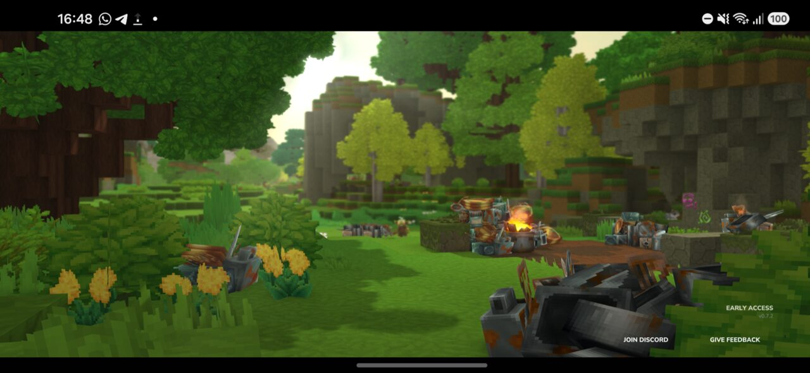 |
| 5 | Complete menu: stack-passed GL arguments, `gl_FragCoord` origin and HTTPS fixed | 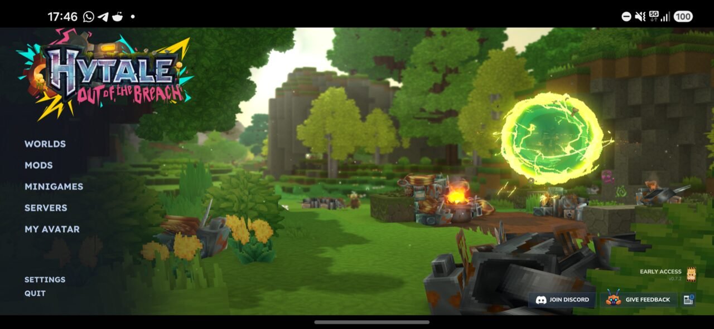 |
| 6 | The account's avatar, after applying GLSL uniform initializers |  |
| 7 | Inside a world on an online server (QUIC + mTLS session certificate) |  |
| 8 | Local world, first try: the client can't find `java` |  |
| 9 | The client starts the bundled Java 25 server by itself |  |
| 10 | In a local world at 60 FPS, with a lighter render profile | 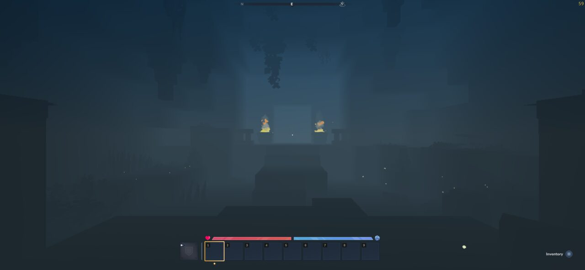 |
| 11 | On-screen gamepad: the game sees an Xbox controller |  |
| 12 | Exploring and fighting (and losing) |  |
| 13 | Lighting debug: the world's real colours, with lighting isolated | 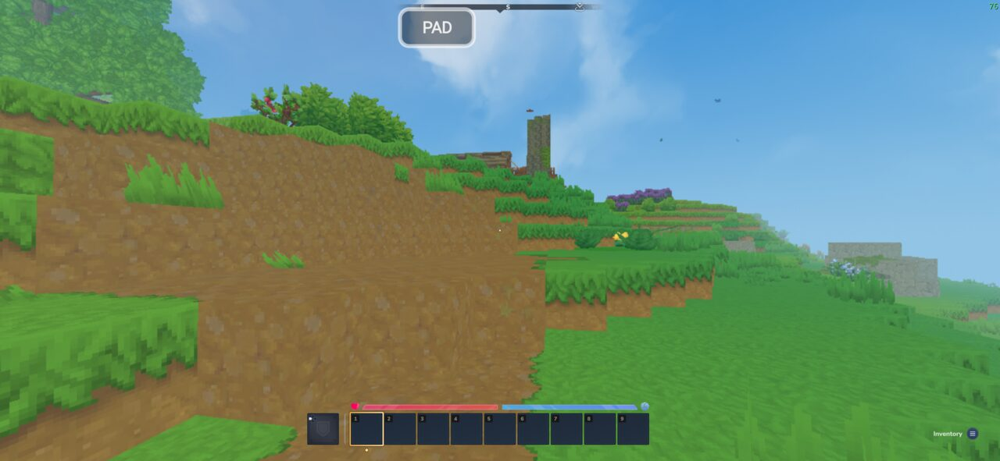 |
| 14 | Lighting fixed: the client's light target was `GL_RGB10`, which OpenGL ES can't render to; the loader now maps it to `RGB10_A2` |  |
| 15 | Block light from torches inside ruins | 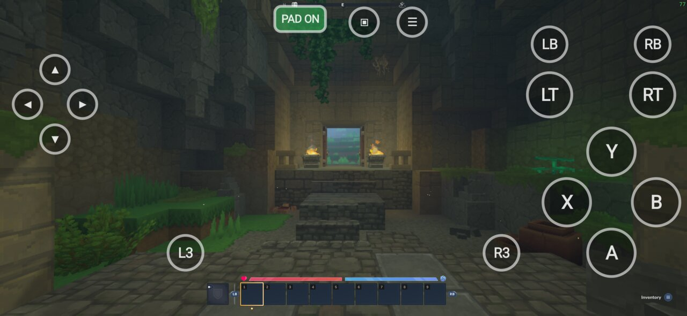 |
| 16 | Forest with the on-screen stick and sunlight through the trees | 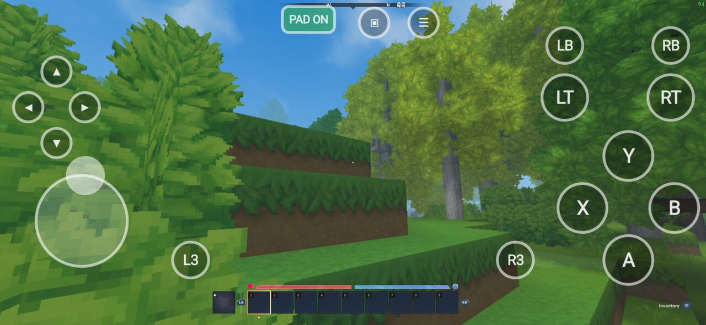 |
| 17 | Gameplay recorded on the phone: 57 FPS while walking, locked to the 60 Hz panel |  |
| 18 | A lighter world server: half the CPU and about 450 MB less memory | 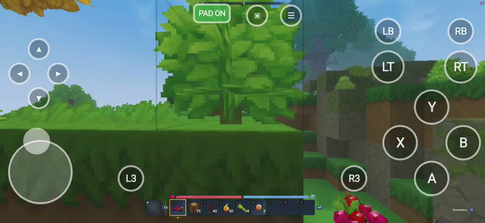 |
| 19 | Fighting a Skeleton Fighter |  |
| 20 | New touch controls: each button shows its action, with the controller label in the corner, matching Hytale's own bindings |  |
| 21 | The launcher laid out for a landscape phone, with the Hytale logo |  |

The detailed log, in Portuguese, is in [progress/PROGRESS.md](progress/PROGRESS.md).

## ✨ Features

| | |
|---|---|
| 🚀 **Native** | The macOS arm64 client (NativeAOT .NET) is mapped by a Mach-O loader and runs directly on the CPU. Only the operating system's interfaces are translated, onto Bionic, SDL3, MobileGlues and OpenAL Soft. |
| 🌍 **Local worlds** | A bundled OpenJDK 25 runs `HytaleServer.jar` on the phone, started by the client as on desktop. The server's native libraries (QUIC, RocksDB, zstd) are built for Android. |
| 🌐 **Online servers** | Session certificate, QUIC with mTLS and HTTPS work over Android's own TLS. |
| 🎮 **Touch controls** | Touch controls drawn like a mobile game: a top bar (exit, emotes, menu, player list, map, show/hide, utility item), sprint and block on the left, jump, crouch, attack and inventory on the right, a stick pad and the hotbar slots as touch targets. They exist only during play: in menus, modals and settings touches are plain input, and two fingers scroll lists. Plugging in a USB or Bluetooth gamepad turns the on-screen one off. The eye button turns the pad on and off; hold it to move and resize buttons. |
| ⚙️ **Settings in the game** | The gear in the touch controls' top bar opens a native panel over the game: 3D resolution (540p down to 240p, for weak phones), battery mode, lighter textures, pre-generating new worlds, and the size, position and opacity of the touch controls. Options read at start ask for a restart, which saves the world first. |
| 🧊 **Runs cooler** | VSync at the 60 Hz panel instead of an uncapped frame rate, sustained-performance mode, a lighter OpenAL mix, and a world server tuned for a phone: bounded heap, fewer GC and JIT threads, no busy-waiting tick, 20 ticks per second, kept off the fastest core. |
| 🔊 **Audio** | OpenAL Soft on OpenSL ES. |
| 📲 **One APK, no computer** | One app holds the launcher and the game. It downloads the official build from Hytale's servers, installs it with a built-in patcher, and sets up the world server's Java and native libraries itself the first time you play. |
| 🔑 **Official sign-in** | The launcher signs in with your Hytale account, keeps the session through network hiccups and hands it to the game. |
| 📱 **Landscape launcher** | The launcher fits a landscape phone: Hytale logo, compact sidebar, full screen. |

## 📋 Requirements

| | |
|---|---|
| **Device** | Android, **ARM64**. Tested on a Galaxy S23 (Snapdragon 8 Gen 2, Adreno 740, Android 16) |
| **Storage** | ~6.5 GB free while installing (2 GB download + 4.2 GB game), ~4.5 GB after, plus ~350 MB for the app and its Java runtime |
| **Game** | Your Hytale account. The game files are downloaded by the app |
| **Input** | On-screen gamepad, a Bluetooth/USB controller, or touch as a mouse |

## 📥 Download

Get **`HytaleMobile-1.0.0.apk`** from the [Releases](https://github.com/BelmanteGu/HytaleMobile/releases) page. That one APK is everything: no computer, no `adb`.

1. Install the APK (allow installs from your browser or file manager).
2. Open **Hytale**, go to **Profiles → Create New Profile** and sign in with your Hytale account.
3. In **Instances**, open **Hytale** and tap **Install**. The app downloads the official macOS build (~2 GB) and installs it.
4. Tap **Launch**. The first time, the app prepares the world server for about 10 seconds; then the game opens.

Keep the phone on Wi-Fi and charging for the first download. Updating from the older two-APK setup: install this APK over the game app (your worlds stay), sign in once, then uninstall the old **Hyprism** launcher app.

## ⚙️ How it works

```
One app, org.hyprism.game
Launcher process (Avalonia, .NET 10)          Game process (:game, no .NET)
 ├─ signs in with the Hytale account           ├─ SetupActivity: Java runtime, server jar
 ├─ downloads the macOS build (.pwr) and       ├─ SDLActivity + on-screen gamepad
 │  applies it with pwrapply                   ├─ libmain.so: Mach-O loader
 └─ starts the game with the session  ──►      │
                                               │   ├─ maps HytaleClient and its dylibs
                                               │   └─ binds macOS imports to shims over
                                               │      Bionic, SDL3, MobileGlues (GL 4.1 on
                                               │      GLES 3.2), OpenAL Soft, Android TLS
                                               └─ local world: the client forks
                                                   files/java ──► OpenJDK 25 (Termux build)
                                                   └─ HytaleServer.jar + Android natives
```

- **Loader** ([Sources/Hyprism.MachOLoader](Sources/Hyprism.MachOLoader)): maps the Mach-O executable, applies fixups and binds imports to shims for libc, CoreFoundation, Objective-C, Security, CommonCrypto, dyld and more. Architecture notes: [Docs/content/en/architecture/android.mdx](Docs/content/en/architecture/android.mdx).
- **Game install** ([Sources/Hyprism.MachOLoader/pwrapply](Sources/Hyprism.MachOLoader/pwrapply)): butler's `apply` (itch.io's wharf library) built without cgo for Android and shipped as a native library, so the launcher installs and updates the official `.pwr` builds on the phone.
- **Local world server** ([Sources/Hyprism.MachOLoader/server](Sources/Hyprism.MachOLoader/server)): the host is built with `targetSdk 28` so the app may run Java from its private directory. A wrapper swaps the client's Shenandoah GC for G1, because Android's seccomp filter blocks `get_mempolicy`. The app makes a local copy of the jar (`ServerSetup.java`, the same changes as `patch-server-jar.py`) that accepts Linux arm64 and skips Netty QUIC (glibc-only), since the client uses the QUICHE transport. quiche 0.30.0 gets the three C functions Hypixel added (DER certificate and key from memory, optional peer verification).

## 🛠️ Building from source

The full guide is in [Docs/content/en/development/android.mdx](Docs/content/en/development/android.mdx). Short version, on Linux or macOS with the Android SDK/NDK, .NET 10, JDK 21, CMake, Ninja and Rust with `cargo-ndk`:

```bash
git clone https://github.com/BelmanteGu/HytaleMobile
cd HytaleMobile/Sources/Hyprism.MachOLoader

./deps.sh && ./build.sh            # SDL3, MobileGlues, OpenAL Soft, the loader
server/build-natives.sh            # the server's natives for Android
server/fetch-jdk.sh /path/to/jdk-25
android/build-bundle.sh            # the game half: classes, libraries, Java runtime, pwrapply (needs Go)

cd ../..
dotnet publish Sources/Hyprism.Android/Hyprism.Android.csproj -c Release   # the single APK
```

The app keeps the game files in `/sdcard/Android/data/org.hyprism.game/files`.

| Script | What it does |
|---|---|
| `deps.sh` | Builds SDL 3, MobileGlues and OpenAL Soft for Android arm64 |
| `build.sh` | Builds the loader (`libmain.so`) and a command-line loader for `adb shell` tests |
| `android/build-apk.sh` | Compiles the game activities (and packages a standalone game APK for loader tests) |
| `android/build-bundle.sh` | Assembles the game half that the single APK packs |
| `server/build-natives.sh` | Builds zstd, RocksDB, quiche and zstd-jni for Android, with the patches in `server/patches` |
| `server/fetch-jdk.sh` | Assembles a trimmed OpenJDK 25 from Termux packages |
| `server/install.sh` | Development only: installs the server runtime on a phone over `adb` |

## 📊 Status

| | |
|:---:|---|
| ✅ | One APK: sign in, download and install the game, play, all on the phone |
| ✅ | Launcher, official sign-in and session hand-off |
| ✅ | Main menu, avatar, audio, online servers |
| ✅ | Local worlds with the server on the phone |
| ✅ | On-screen gamepad, Bluetooth/USB controllers |
| ✅ | ~60 FPS at 50% render scale and 64-block view distance |
| ✅ | World lighting: sun, sky ambient, torch light and shadows (the deferred "full light" target was `GL_RGB10`, which OpenGL ES can't render to) |
| ✅ | World server on the phone: about 1 CPU core instead of 2, ~700 MB instead of ~1.2 GB |
| 🚧 | Exploring new land still costs CPU while the server generates it; a pre-generated area (made on a computer) avoids it |
| 🚧 | Signing in from the phone's browser: Cloudflare's check may not finish in Chrome; the launcher logs the sign-in link so it can be finished on a computer with `adb forward` |
| 🚧 | The client closes with *Broken pipe* if the local server stops |

## ⚖️ Legal

- Hytale © Hypixel Studios. This project is **not affiliated with or endorsed by** Hypixel Studios.
- The Hytale logo at the top of this page is © Hypixel Studios and is used only to identify the game.
- This repository contains **no** game code or assets. The client and server are loaded from the user's own files; the server jar is adapted on the user's own phone, as a copy, and nothing from it is distributed.
- The launcher and loader are GPL-3.0, like Hyprism. Third-party components keep their own licenses, listed in [THIRD_PARTY_NOTICES.md](THIRD_PARTY_NOTICES.md).

## 💜 Credits

- [Hyprism](https://github.com/hyprismteam/Hyprism), the launcher this project is built on, by the Hyprism team and contributors
- [SDL](https://libsdl.org/), [MobileGlues](https://github.com/MobileGL-Dev/MobileGlues) and [OpenAL Soft](https://github.com/kcat/openal-soft) on the client side
- [.NET](https://dotnet.microsoft.com/) and [Avalonia](https://avaloniaui.net/) for the launcher
- [OpenJDK](https://openjdk.org/) as packaged by [Termux](https://termux.dev/), and the CA trust store from [Eclipse Temurin](https://adoptium.net/)
- [quiche](https://github.com/cloudflare/quiche) and BoringSSL, [RocksDB](https://rocksdb.org/), [zstd](https://github.com/facebook/zstd) and [zstd-jni](https://github.com/luben/zstd-jni) for the server
- **Touch controls:** the layout, proportions and look of the on-screen controls (top bar, octagon buttons, stick pad, diamond knob) follow the mobile-game controls shown by the YouTube channel **[Zhondre](https://www.youtube.com/@Zhondre)**; the glyphs were cut from the reference images they came from. Thanks to Zhondre for the design.
- And Hytale by Hypixel Studios. Get it if you haven't.

<div align="center">

**Made by [Projeto Belmante](https://www.youtube.com/@belmante)** · GPL-3.0 · Third-party components keep their own licenses ([THIRD_PARTY_NOTICES.md](THIRD_PARTY_NOTICES.md))

</div>
