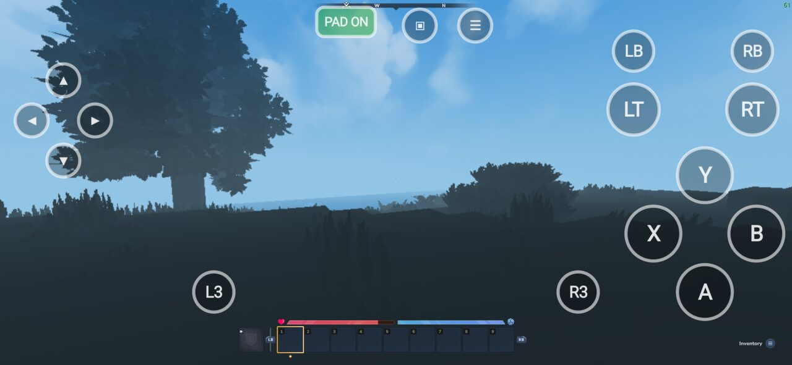
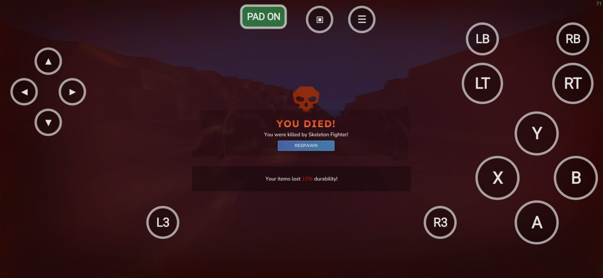
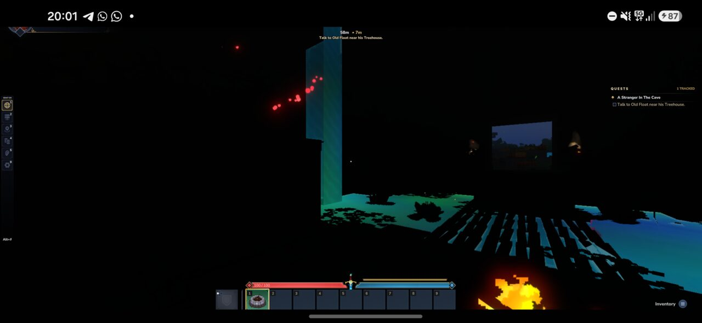
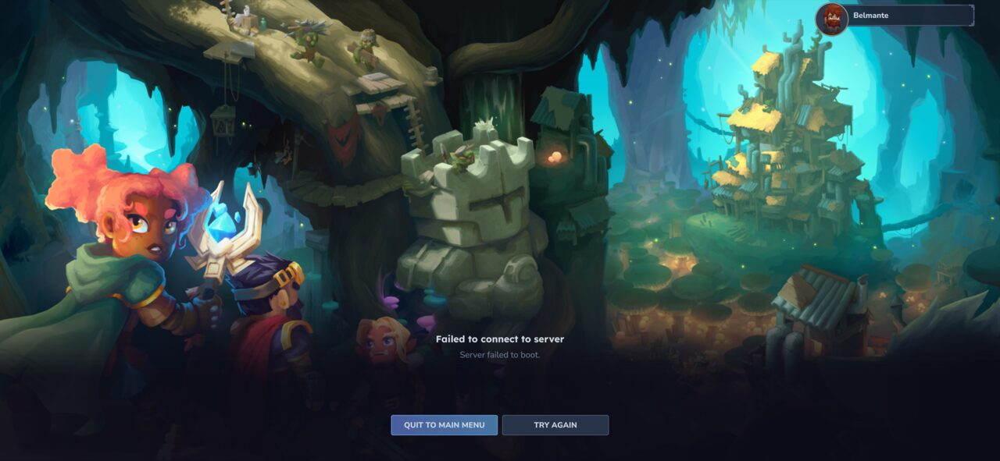

<!--
Copyright (C) 2026 Hyprism Launcher
SPDX-License-Identifier: GPL-3.0-only
-->

<div align="center">


# HytaleMobile

**Hytale running natively on Android, from your own account and game files.**

The macOS arm64 client runs straight on the phone's CPU: no emulator, no FEX, no Box64.<br>
A Mach-O loader translates only the operating system, and a bundled Java 25 runs the local world server on the phone.


<a href="LICENSE"></a>

<a href="#%EF%B8%8F-how-it-works"></a>
<a href="Docs/content/en/development/android.mdx"></a>
<a href="https://www.youtube.com/@belmante"></a>


<sub>A local world on a Galaxy S23, with the server running on the phone. This frame shows the world's own colours (the lighting pass is still being fixed, see <a href="#-status">Status</a>).</sub>

</div>

---

> [!IMPORTANT]
> **No game files are included.** This project doesn't contain Hytale, its client, server or assets. You need your own Hytale account and the **macOS** game files (release build 34 was tested). The launcher signs in with your official account.

> [!NOTE]
> This is a fork of the [Hyprism](https://github.com/hyprismteam/Hyprism) launcher. It is a work in progress tested on one phone, and it isn't affiliated with Hypixel Studios.

## 📸 Screenshots

<div align="center">

| Touch gamepad | Combat |
|:---:|:---:|
|  |  |
| **Main menu with your avatar** | **Hyprism launcher** |
|  |  |

</div>

## 🧭 Evolution

From the first window to a local world with the server on the phone, in order:

| # | Step | |
|:---:|---|:---:|
| 1 | The Hyprism launcher as an APK, signing in with the official account |  |
| 2 | The macOS client's first window: no OpenGL yet |  |
| 3 | Out of memory from the .NET thunk pool, fixed with 16 KiB-aligned `vm_remap` |  |
| 4 | Main menu with the 3D scene, but no interface images |  |
| 5 | Complete menu: stack-passed GL arguments, `gl_FragCoord` origin and HTTPS fixed |  |
| 6 | The account's avatar, after applying GLSL uniform initializers |  |
| 7 | Inside a world on an online server (QUIC + mTLS session certificate) |  |
| 8 | Local world, first try: the client can't find `java` |  |
| 9 | The client starts the bundled Java 25 server by itself |  |
| 10 | In a local world at 60 FPS, with a lighter render profile |  |
| 11 | On-screen gamepad: the game sees an Xbox controller |  |
| 12 | Exploring and fighting (and losing) |  |
| 13 | Lighting debug: the world's real colours, with lighting isolated |  |

The detailed log, in Portuguese, is in [progress/PROGRESS.md](progress/PROGRESS.md).

## ✨ Features

| | |
|---|---|
| 🚀 **Native** | The macOS arm64 client (NativeAOT .NET) is mapped by a Mach-O loader and runs directly on the CPU. Only the operating system's interfaces are translated, onto Bionic, SDL3, MobileGlues and OpenAL Soft. |
| 🌍 **Local worlds** | A bundled OpenJDK 25 runs `HytaleServer.jar` on the phone, started by the client as on desktop. The server's native libraries (QUIC, RocksDB, zstd) are built for Android. |
| 🌐 **Online servers** | Session certificate, QUIC with mTLS and HTTPS work over Android's own TLS. |
| 🎮 **Touch gamepad** | An on-screen gamepad feeds an SDL virtual controller: stick to move, swipe to look, ABXY, triggers, bumpers, D-pad and menus. The **PAD** button turns it off so touches act as a mouse in menus. |
| 🔊 **Audio** | OpenAL Soft on OpenSL ES. |
| 🔑 **Official sign-in** | The Hyprism launcher signs in with your Hytale account and hands the session to the game. |

## 📋 Requirements

| | |
|---|---|
| **Device** | Android, **ARM64**. Tested on a Galaxy S23 (Snapdragon 8 Gen 2, Adreno 740, Android 16) |
| **Storage** | ~4.5 GB for the game files, ~200 MB for the Java runtime |
| **Game** | Your Hytale account and the **macOS** client files (`Client`, `Assets.zip`, `Server`), release build 34 |
| **Input** | On-screen gamepad, a Bluetooth/USB controller, or touch as a mouse |

## ⚙️ How it works

```
Hyprism launcher (Avalonia, .NET 10)          Game host (org.hyprism.game)
 ├─ signs in with the Hytale account           ├─ SDLActivity + on-screen gamepad
 └─ starts the host with the session  ──►      ├─ libmain.so: Mach-O loader
                                               │   ├─ maps HytaleClient and its dylibs
                                               │   └─ binds macOS imports to shims over
                                               │      Bionic, SDL3, MobileGlues (GL 4.1 on
                                               │      GLES 3.2), OpenAL Soft, Android TLS
                                               └─ local world: the client forks
                                                   files/java ──► OpenJDK 25 (Termux build)
                                                   └─ HytaleServer.jar + Android natives
```

- **Loader** ([Sources/Hyprism.MachOLoader](Sources/Hyprism.MachOLoader)): maps the Mach-O executable, applies fixups and binds imports to shims for libc, CoreFoundation, Objective-C, Security, CommonCrypto, dyld and more. Architecture notes: [Docs/content/en/architecture/android.mdx](Docs/content/en/architecture/android.mdx).
- **Local world server** ([Sources/Hyprism.MachOLoader/server](Sources/Hyprism.MachOLoader/server)): the host is built with `targetSdk 28` so the app may run Java from its private directory. A wrapper swaps the client's Shenandoah GC for G1, because Android's seccomp filter blocks `get_mempolicy`. `patch-server-jar.py` makes a local copy of the jar accept Linux arm64 and skips Netty QUIC (glibc-only), since the client uses the QUICHE transport. quiche 0.30.0 gets the three C functions Hypixel added (DER certificate and key from memory, optional peer verification).

## 🛠️ Building from source

The full guide is in [Docs/content/en/development/android.mdx](Docs/content/en/development/android.mdx). Short version, on Linux or macOS with the Android SDK/NDK, .NET 10, JDK 21, CMake, Ninja and Rust with `cargo-ndk`:

```bash
git clone https://github.com/BelmanteGu/HytaleMobile
cd HytaleMobile

# Launcher APK
dotnet publish Sources/Hyprism.Android/Hyprism.Android.csproj -c Release

# Game host APK (loader, SDL3, MobileGlues, OpenAL Soft)
cd Sources/Hyprism.MachOLoader
./deps.sh && ./build.sh && android/build-apk.sh
adb install -r out/hyprism-game.apk

# Local world server: natives, Java runtime, install on the phone
server/build-natives.sh
server/fetch-jdk.sh /path/to/a/jdk-25
server/install.sh /path/to/your/Server/HytaleServer.jar
```

The game files go to `/sdcard/Android/data/org.hyprism.game/files` (see the guide).

| Script | What it does |
|---|---|
| `deps.sh` | Builds SDL 3, MobileGlues and OpenAL Soft for Android arm64 |
| `build.sh` | Builds the loader (`libmain.so`) and a command-line loader for `adb shell` tests |
| `android/build-apk.sh` | Packages the game host APK without Gradle |
| `server/build-natives.sh` | Builds zstd, RocksDB, quiche and zstd-jni for Android, with the patches in `server/patches` |
| `server/fetch-jdk.sh` | Assembles a trimmed OpenJDK 25 from Termux packages |
| `server/install.sh` | Patches your `HytaleServer.jar` locally and installs the server runtime on the phone |

## 📊 Status

| | |
|:---:|---|
| ✅ | Launcher, official sign-in and session hand-off |
| ✅ | Main menu, avatar, audio, online servers |
| ✅ | Local worlds with the server on the phone |
| ✅ | On-screen gamepad, Bluetooth/USB controllers |
| ✅ | ~60 FPS at 50% render scale and 64-block view distance |
| 🚧 | **World lighting**: terrain is drawn but the deferred light term reaches the screen as zero, so the world looks dark. Albedo and shadows are correct (screenshot 13); the light buffer is being investigated |
| 🚧 | Signing in from the phone's browser: Cloudflare's check doesn't finish in Chrome; signing in on a computer with `adb forward` works |
| 🚧 | The client closes with *Broken pipe* if the local server stops |

## ⚖️ Legal

- Hytale © Hypixel Studios. This project is **not affiliated with or endorsed by** Hypixel Studios.
- The Hytale logo at the top of this page is © Hypixel Studios and is used only to identify the game.
- This repository contains **no** game code or assets. The client and server are loaded from the user's own files; `patch-server-jar.py` modifies a copy on the user's machine and nothing from the jar is distributed.
- The launcher and loader are GPL-3.0, like Hyprism. Third-party components keep their own licenses, listed in [THIRD_PARTY_NOTICES.md](THIRD_PARTY_NOTICES.md).

## 💜 Credits

- [Hyprism](https://github.com/hyprismteam/Hyprism), the launcher this project is built on, by the Hyprism team and contributors
- [SDL](https://libsdl.org/), [MobileGlues](https://github.com/MobileGL-Dev/MobileGlues) and [OpenAL Soft](https://github.com/kcat/openal-soft) on the client side
- [.NET](https://dotnet.microsoft.com/) and [Avalonia](https://avaloniaui.net/) for the launcher
- [OpenJDK](https://openjdk.org/) as packaged by [Termux](https://termux.dev/), and the CA trust store from [Eclipse Temurin](https://adoptium.net/)
- [quiche](https://github.com/cloudflare/quiche) and BoringSSL, [RocksDB](https://rocksdb.org/), [zstd](https://github.com/facebook/zstd) and [zstd-jni](https://github.com/luben/zstd-jni) for the server
- And Hytale by Hypixel Studios. Get it if you haven't.

<div align="center">

**Made by [Projeto Belmante](https://www.youtube.com/@belmante)** · GPL-3.0 · Third-party components keep their own licenses ([THIRD_PARTY_NOTICES.md](THIRD_PARTY_NOTICES.md))

</div>
