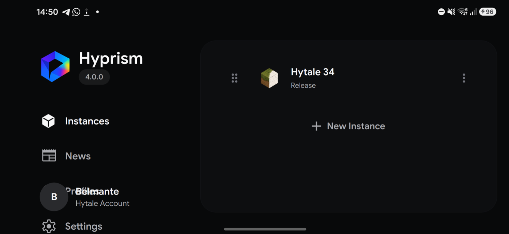
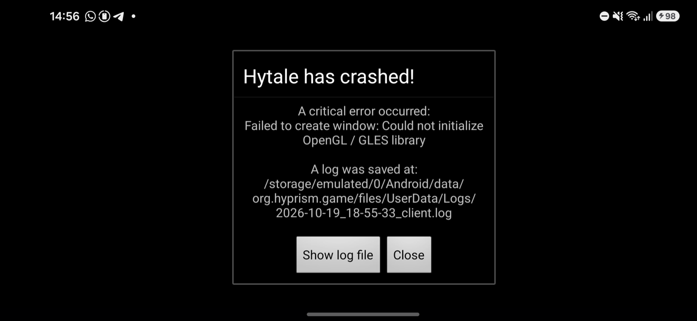
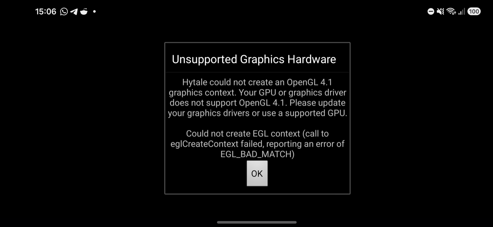
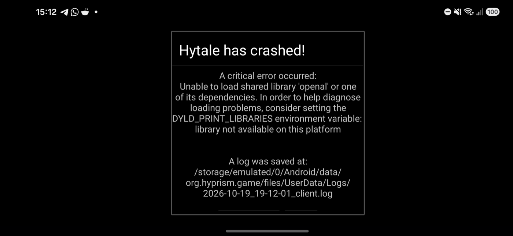
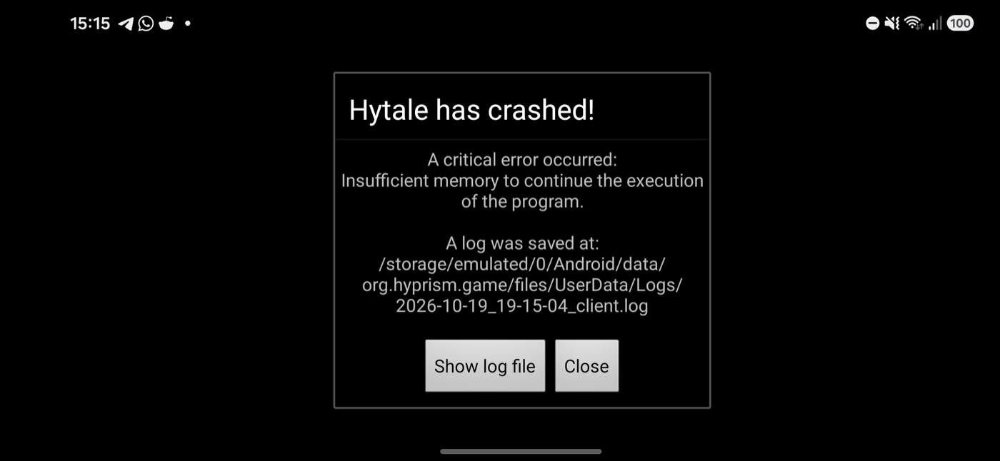
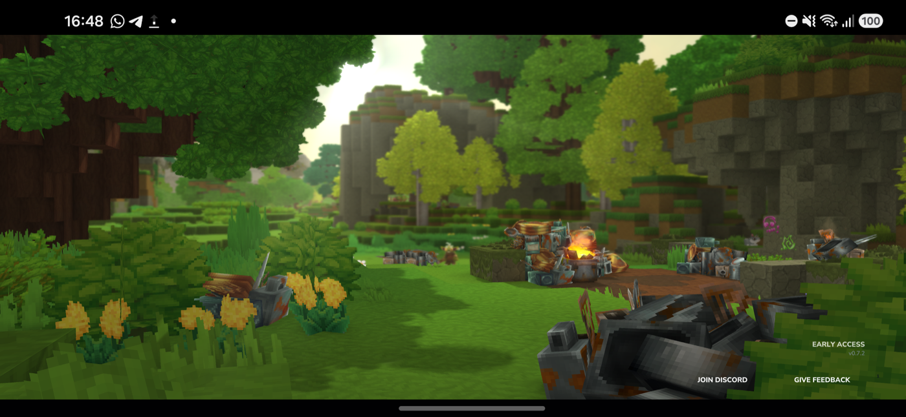
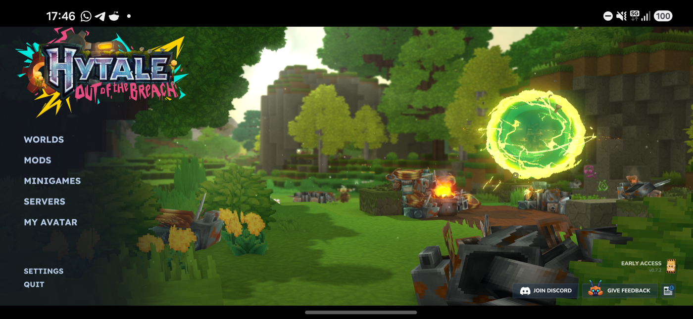
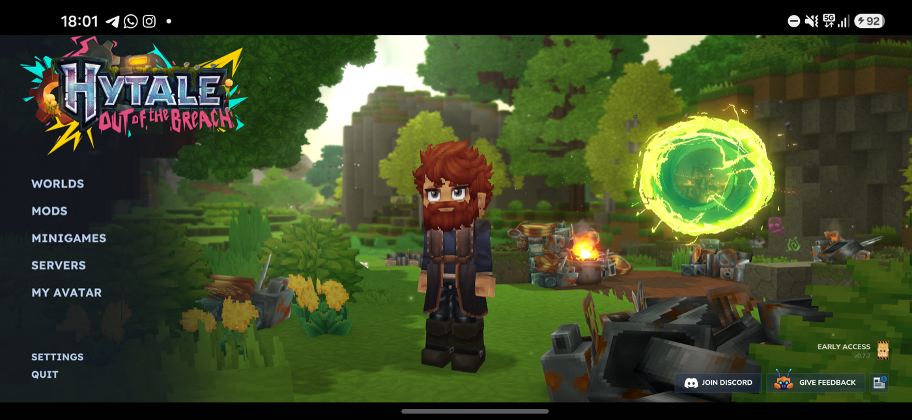
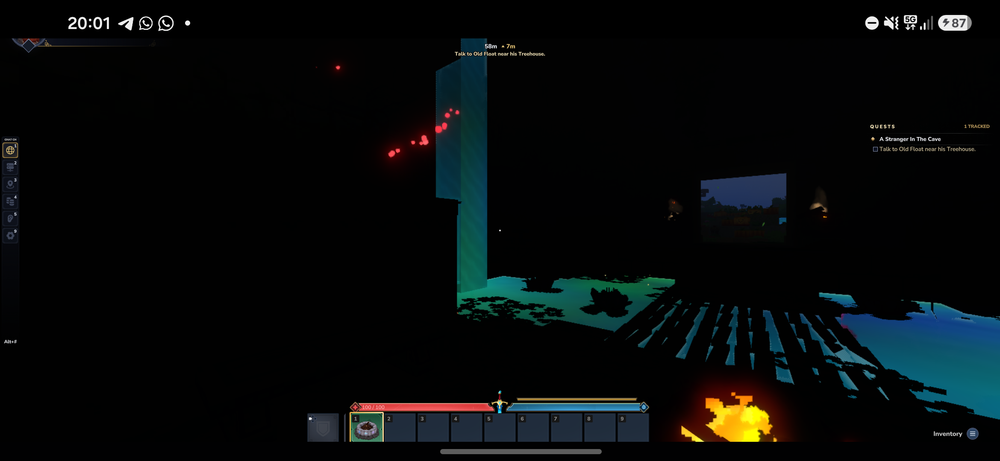

# Progresso: Hytale no Android pelo Hyprism

Diário do port. O objetivo é rodar o cliente **macOS arm64** do Hytale nativamente no Android, sem emulador de CPU (sem FEX e sem Box64), com o Hyprism como launcher. As instruções arm64 do jogo rodam direto no processador; só as interfaces do sistema operacional são traduzidas.

- Aparelho de teste: Galaxy S23 (Snapdragon 8 Gen 2, Adreno 740, Android 16).
- Cliente: Hytale release build 34 (v0.7.2), cópia da instalação do Mac.
- Branch: `feature/android-apk`.
- Documentação técnica: [arquitetura](../Docs/content/en/architecture/android.mdx) e [desenvolvimento](../Docs/content/en/development/android.mdx).

## Estado atual

| Área | Estado |
| --- | --- |
| Launcher Hyprism no Android | Funciona: login oficial e envio dos tokens para o jogo |
| Carregador Mach-O | Carrega o cliente e as dylibs do macOS |
| Gráficos (OpenGL 4.1 via MobileGlues) | Cena 3D, interface, logo, botões e ícones aparecem |
| Áudio (OpenAL Soft) | Funciona |
| Rede e HTTPS | Funciona: perfil, skins, cosméticos, configuração online, gateway e lista de servidores |
| Menu principal | Completo: Worlds, Mods, Minigames, Servers, My Avatar, Settings e Quit |
| Personagem no menu | Funciona: o avatar da conta aparece no centro do menu |
| Entrar em servidor online | Ainda não: o certificado de sessão (mTLS) não é gerado; o servidor responde `Client certificate required for mTLS connection` |
| Entrar em mundo local | Ainda não: o cliente sobe o servidor do mundo como outro processo (Java), que ainda não existe no Android |
| Toque | Só como mouse |

## Linha do tempo

### 1. Hyprism no Mac

O Hyprism foi clonado e validado no Mac: o launcher abriu a instalação do Hytale para macOS, que já é arm64. A ideia veio daí: se o jogo do Mac é arm64, o processador do Android executa as mesmas instruções.

### 2. Launcher Hyprism como APK

Commits `a80465b7`, `e360374b` e `385e50b3`.

- O conteúdo da janela virou `MainView`, que o Android mostra direto na activity.
- O Core passou a entregar o lançamento para um host externo (`IExternalGameHost`), com nome, UUID, modo de autenticação e tokens.
- Novo projeto `Hyprism.Android` (Avalonia para Android).

### 3. Carregador Mach-O nativo

Commit `cd76f200`.

Um carregador próprio mapeia o executável do macOS e as dylibs, aplica os fixups e liga os imports do macOS a "shims" sobre a libc do Android (Bionic), SDL 3, MobileGlues e OpenAL Soft. O APK host (`org.hyprism.game`) é uma activity SDL que roda o cliente.

Os primeiros testes chegaram à janela do jogo e foram passando erro por erro:

Também foram corrigidos `___chkstk_darwin` (tamanho em `x9`), o espelho de errno, a tabela de `ctype` do macOS (que fazia o XAML do Noesis falhar) e um bug do MobileGlues em `glShaderSource`.

### 4. Menu sem imagens

O jogo chegou ao menu com cena 3D, texto e áudio, mas sem as imagens da interface.

### 5. Imagens, HTTPS e menu completo

Commits `026447cd` e `1d02698d`, documentados em `2cbef9d4`.

Três defeitos explicavam o menu incompleto:

1. **Atlas da interface vazio.** No macOS arm64, argumentos de função passados pela pilha ficam compactados (4 bytes cada); no Android cada um ocupa 8. `glTexSubImage3D` tem 11 argumentos, então o tipo do pixel chegava errado e o envio do atlas falhava. Agora um trampolim lê a pilha com o layout do macOS.
2. **Botões sumidos.** O shader da interface usa `gl_FragCoord` com origem no canto superior esquerdo, o que o OpenGL ES não suporta. Com o Y invertido, só o que estava no meio da tela passava no teste de máscara. O shader agora é reescrito para inverter o Y.
3. **Sem HTTPS.** O SecureTransport do macOS agora roda sobre o TLS do próprio Android (`SSLEngine`), com validação de certificados pela loja do sistema. Junto veio a correção do errno 11 (`EAGAIN` no Linux, `EDEADLK` no macOS), que fazia toda leitura de socket parecer erro.

Com isso o jogo baixa perfil, skins e configuração online, e o menu aparece inteiro:

### 6. Personagem no menu

Commit `cd32d9ea`.

O personagem era desenhado, mas invisível. O shader dos modelos declara valores padrão em uniforms, como `uniform float uGlobalTransparency = 1.0;`, e o GLSL do OpenGL ES não tem isso: o valor virava 0. A prévia do avatar usa esse caminho, então saía com transparência 0. Agora os valores padrão são lidos do código do shader e aplicados depois de cada `glLinkProgram`.

### 7. Rumo à primeira partida (em andamento)

Para entrar em qualquer servidor, online ou local, o cliente gera um certificado de sessão autoassinado (RSA 2048) e o usa no QUIC (`libquiche`) com mTLS. No macOS isso passa pela API de chaves da Apple (`SecKey*`), pelo `SecItemExport`/`SecItemImport` e por um keychain temporário. Já existe:

- `SecKey*`, `SecIdentity*`, `SecItem*` e keychains em memória (`src/security.c`), com a criptografia no Java do Android (`KeyBridge.java`).
- Exportação da chave privada como PKCS#8 cifrado (PBES2), que o .NET lê. Foi testado no Mac contra o .NET de verdade, com e sem senha.

**Certificado de sessão.** Dois defeitos impediam a geração. O .NET cifra a chave exportada com 3DES-CBC, e o shim do `CCCryptor` só tinha AES (erro `-4305`). Depois ele reimporta a chave como PKCS#1 sem cifra pelo `SecItemImport`, que não aceitava o formato OpenSSL (erro `-25257`). Os dois estão corrigidos em `src/crypto.c` e `src/security.c`; o 3DES foi conferido contra o `openssl`.

**QUIC e entrada em servidor.** Faltavam funções do macOS no `libquiche`. As que importavam foram implementadas em `src/shims.c` e `src/posix.c`: `pthread_once` (sem ela o BoringSSL embutido nunca inicializava e a chave falhava com `-10`), semáforos do dispatch, `writev`, `dirfd`, `feof`/`ferror`/`fgets` e as consultas ao dyld. As funções de exceção C++ continuam sem implementação, e só importam se alguma exceção for lançada. O cliente conecta ao servidor online, baixa os assets e entra no mundo, depois de duas funções do CoreGraphics (`CGAssociateMouseAndMouseCursorPosition` e `CGSetLocalEventsSuppressionInterval`) virarem no-ops.

Defeitos conhecidos dessa primeira partida:

- A cena 3D sai escura: o terreno fica preto e só o que emite luz aparece (fogueira, partículas, vidro). Nenhum shader falha ao compilar ou ao fazer link (o cliente registra isso agora), todos os framebuffers ficam completos e não há erros de GL. A fogueira não ilumina o que está ao redor, o que aponta para a luz dinâmica (grade de clusters) ou para as texturas de terreno. Ainda sem causa confirmada.
- `std::sort<unsigned short>` (`__ZNSt3__16__sortIRNS_6__lessIttEEPtEEvT0_S5_T_`) do `libquiche` ainda não tem implementação.
- `backtrace`, `newlocale` e as fontes do CoreText seguem como `UNIMPLEMENTED`.

O mundo local é outra frente: o cliente sobe o servidor Java (`Server/HytaleServer.jar`, Java 25) com bibliotecas nativas que só existem para `linux-x64`, `win-x64` e `osx-arm64` (`libquiche`, `librocksdb`, `libzstd`). Rodar o Java do macOS pelo carregador exigiria ~450 funções novas, incluindo desenrolamento de exceções C++; a alternativa é um JDK para Android e recompilar essas três bibliotecas.

## Próximos passos

1. Achar a causa da cena escura (ver defeitos conhecidos). O `glClearTexSubImage` já recebe os argumentos de pilha no layout certo, mas isso não mudou a imagem.
2. Implementar `std::sort<unsigned short>` e as demais funções do `libquiche` que ainda são stubs.
3. Decidir o caminho do servidor local (Java do macOS pelo carregador ou JDK para Android). O `HytaleServer.jar` também precisa estar no aparelho.
4. Tela cheia: feito, a barra de status e a de navegação ficam escondidas (`HytaleActivity`).
5. Controles de toque.
6. Launcher: sair do estado "Launching" depois de abrir o jogo, e corrigir o menu de três pontos da conta.

## Continuar em outra máquina (Linux)

Tudo o que é preciso está no repositório, menos os arquivos do jogo, que já estão no S23.

1. Instale o .NET 10 SDK com a workload `android`, o JDK 21, o Android SDK (build tools 35, platform 35, NDK), CMake, Ninja e Git. Defina `ANDROID_HOME` se o SDK não estiver em `~/Android/Sdk`.
2. Clone `BelmanteGu/HyprismMobile` e use o branch `feature/android-apk`.
3. Siga o [guia de desenvolvimento](../Docs/content/en/development/android.mdx): `deps.sh`, `build.sh` e `android/build-apk.sh` dentro de `Sources/Hyprism.MachOLoader`, e `dotnet publish` para o launcher.
4. Os arquivos do Hytale (`Client`, `Assets.zip`, `UserData`) continuam em `/sdcard/Android/data/org.hyprism.game/files` no aparelho. Reinstalar o APK host com `adb install -r` não apaga esses arquivos; desinstalar apaga.
5. Para testar: abra o launcher, selecione a instância e toque em **Launch**. Para entrar num servidor sem tocar na tela, rode `android/test-server.sh` em `Sources/Hyprism.MachOLoader`; para o fluxo de mundo local, `android/test-world.sh`. Logs: `adb logcat -s HytaleLoader Hytale`.

Só os testes que comparam com as bibliotecas da Apple (`tests/crypto_vs_commoncrypto.c` e `tests/cxx_string_vs_libcxx.cpp`) precisam de um Mac.

## Atualização de 22/11/2026

- **Mundo local funcionando:** o cliente inicia sozinho um OpenJDK 25 (build do Termux) dentro do app, com as bibliotecas nativas do servidor compiladas para Android (quiche 0.30.0 com as três funções da Hypixel, RocksDB 11.2, zstd e zstd-jni). O host passou a `targetSdk 28` para poder executar o Java, e um *wrapper* troca o Shenandoah pelo G1 porque o seccomp do Android bloqueia `get_mempolicy`. Ferramentas em `Sources/Hyprism.MachOLoader/server`.
- **Carregador:** `fork`/`execve`, `-[NSProcessInfo environment]`, `newlocale`, `strtod_l`, `backtrace` e `-[NSArray lastObject]`.
- **Gamepad na tela:** um controle virtual do SDL; o jogo o reconhece como controle Xbox.
- **Desempenho:** 48 → 60 FPS com escala de render 50% e distância de visão de 64 blocos.
- **Iluminação:** corrigida. O cliente cria o alvo de luz do G-buffer (`outColor2`, "Full light") com `GL_RGB10` (`0x8052`), formato que só existe no OpenGL de desktop: o OpenGL ES não permite desenhar nele, então a luz do terreno nunca chegava à tela. O loader (`fix_TexImage2D` em `gl.c`) troca esse formato por `GL_RGB10_A2`. Como isolar: `HYPRISM_SHADER_REPLACE` mostrou albedo, normal, oclusão e uniformes do sol corretos e só a luz zerada; o `HYPRISM_GL_TRACE` mostrou o formato do anexo 2 do framebuffer. Imagens 14 a 16 do README.
- **Medição:** `HYPRISM_PERF=1` loga FPS e tempo de quadro a cada 2 s. No S23, em movimento, o modo de economia de energia do Android (GPU presa em 220 MHz) derrubava a média de ~69 para ~46 FPS; a memória (cliente ~2,5 GB, 1,4 GB deles de gráficos, mais ~950 MB do servidor Java) também pesa.
- **Suavidade (branch `dev`, ainda sem teste no aparelho):** o cliente roda sem VSync e sem limite, então no S23 (tela de 60 Hz) renderizava 70 a 100 quadros por segundo que ninguém via; isso só esquenta o SoC, que passa a limitar a GPU. Agora o loader força VSync (`HYPRISM_VSYNC=0` desliga) e o host Android se declara jogo (`appCategory`), pede modo de desempenho sustentado, fixa a atualização em 60 Hz (`HYPRISM_REFRESH` no `env.txt`, 0 deixa para o sistema), mantém a tela ligada e avisa quando a economia de energia está ligada ou o aparelho está quente. `android/bench.sh` repete o benchmark de movimento. **Validar com o aparelho:** comparar `bench.sh` com e sem `HYPRISM_VSYNC=0` e `HYPRISM_REFRESH=0`, mesmo lugar do mundo e aparelho frio. Mods de servidor de desempenho (HyFine, LeanCore, QuantumHy) ainda não foram testados com o servidor do build 34.
- **Servidor mais leve (branch `dev`, medido no emulador Android, ainda sem teste no S23):** o cliente sobe o servidor com as opções do desktop (`-Xms768M` e nenhum `-Xmx`), então a JVM cresce até 1/4 da RAM e não devolve memória. O wrapper `server/java` agora limita e encolhe o heap (256 MB a 1,5 GB, `HYPRISM_SERVER_HEAP`; G1 devolve memória ociosa), usa 2 threads de GC e 2 de JIT, roda o servidor fora do(s) núcleo(s) mais rápido(s) (`HYPRISM_SERVER_CORES`) com prioridade abaixo do jogo, e cria no aparelho um cache AOT do JDK 25 (1º mundo grava, 2º cria o cache em segundo plano, depois usa; `HYPRISM_SERVER_AOT=0` desliga). O APK leva o wrapper em `assets/java` e o instala em `files/java` ao abrir. Medido com o servidor do build 34 num emulador arm64 (API 35, JDK do Termux, mundo novo, sem jogador): RSS de 1.161–1.173 MB para 689–746 MB, CPU para subir de 46–48 s para 41–44 s, boot de 15,5–19,5 s para 13–14,5 s. No Mac (JDK 26): memória comprometida de 3.208 MB para 656 MB. Falta medir no S23 com jogador andando (heap com chunks carregados, temperatura).
- **Reescrever o servidor fora do Java:** não é viável. O `HytaleServer.jar` é código fechado da Hypixel (107 MB), muda a cada atualização e carrega plugins e mods por reflexão; compilá-lo com GraalVM `native-image` exigiria um alvo Android/Bionic que o GraalVM não suporta e distribuir um derivado do servidor. O caminho é afinar a JVM, como acima.
